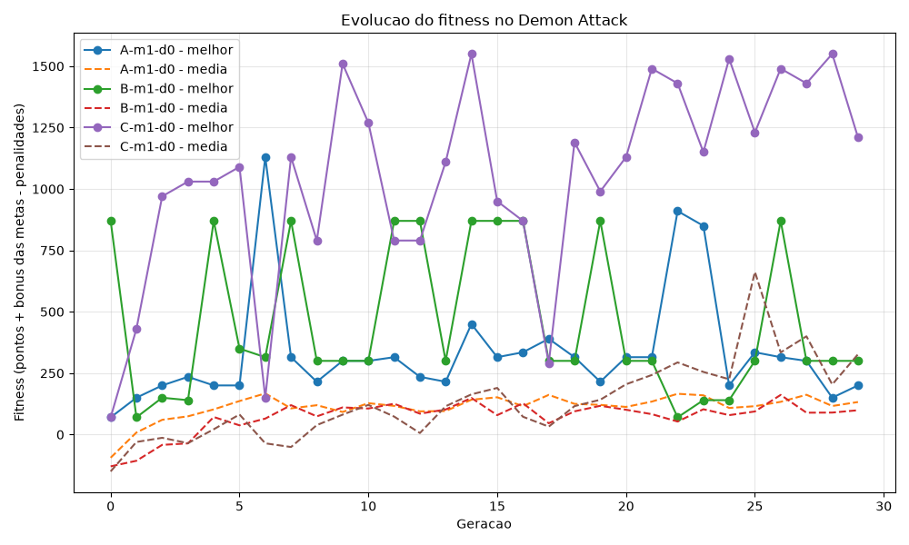
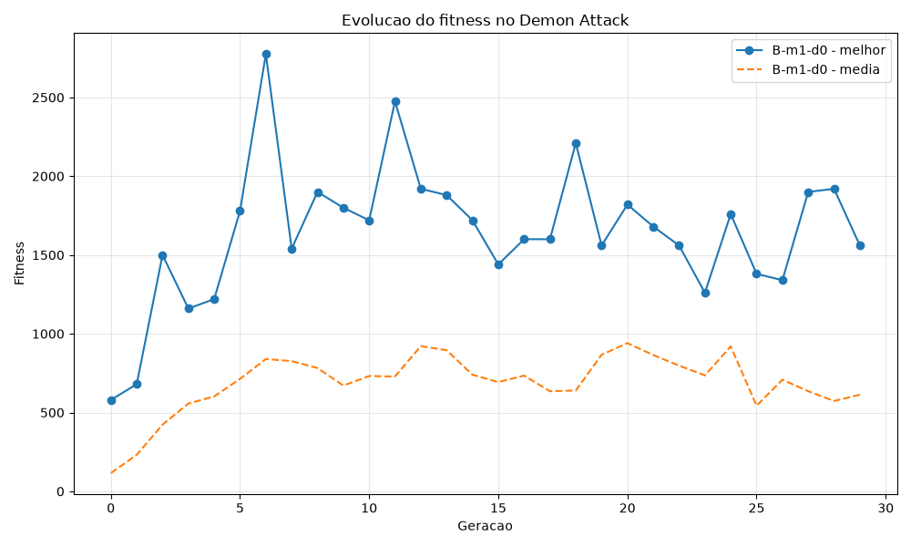

# Demon Attack — Neuroevolução

Projeto em Python que utiliza um algoritmo evolutivo para treinar uma rede neural a jogar **Demon Attack**, do Atari 2600, no ambiente `ALE/DemonAttack-v5` do Gymnasium.

O agente recebe os 128 valores da RAM do jogo, processa uma camada oculta de 64 neurônios e escolhe uma entre 6 ações. A evolução utiliza seleção por ranking, elitismo e mutação dos pesos e bias. O fitness é a pontuação da partida mais bônus por metas, menos uma penalidade por vida perdida. O programa também avalia um agente de ações aleatórias com a mesma regra como referência (baseline).

## Estrutura da entrega

```text
demonAttack/
├── main.py                 # Entrada para executar o projeto
├── demonAttack.py          # Implementação do agente e do algoritmo evolutivo
├── README.md
├── requirements.txt        # Versões das dependências do ambiente verificado
├── resultados/
│   ├── fitness.csv
│   ├── fitness.png
│   ├── baseline.txt
│   ├── melhor_agente.txt
│   └── melhor_agente.pkl
├── resultados_penalizados/ # A/B/C com penalidade por vida, sem metas
├── resultados_metas/       # A/B/C com penalidade e bônus por metas
├── tests/                  # Testes automatizados com ambiente simulado
└── resultados_teste/       # Teste curto anterior
```

`main.py` chama a implementação de `demonAttack.py`. Entregue a pasta completa, incluindo ambos os arquivos Python. O comando antigo `python demonAttack.py` continua funcionando.

**Situação das evidências:** `resultados/` contém B sem penalidades ou bônus; `resultados_penalizados/` contém A/B/C com penalidade por vida; e `resultados_metas/` contém A/B/C com penalidade e bônus por metas. Cada pasta preserva seu CSV, gráfico, baseline, resumo e agente campeão. A execução mais recente está analisada na seção **Resultados com metas**.

## Requisitos e instalação

- Python 3 de 64 bits, com `pip` e `venv` disponíveis. O ambiente verificado usa Python 3.14.8 no Windows; as versões das quatro bibliotecas estão em `requirements.txt`.
- Dependências: `gymnasium`, `ale-py`, `numpy` e `matplotlib`.
- Ambiente gráfico para abrir a janela do jogo nos comandos de visualização.

### Windows (PowerShell)

No terminal, entre na pasta que contém `demonAttack.py`. Se estiver na pasta `trabalhoFacul`, execute:

```powershell
cd demonAttack
python -m venv .venv
.\.venv\Scripts\Activate.ps1
python -m pip install --upgrade pip
python -m pip install -r requirements.txt
```

O arquivo `requirements.txt` inclui o suporte Atari (`ale-py`). Nas versões atuais do ALE, as ROMs já acompanham o pacote, sem necessidade de executar AutoROM. Veja a [documentação oficial do ALE](https://ale.farama.org/release_notes/).

Se o PowerShell bloquear a ativação do ambiente, use diretamente seu executável, sem alterar a política de execução:

```powershell
.\.venv\Scripts\python.exe -m pip install --upgrade pip
.\.venv\Scripts\python.exe -m pip install -r requirements.txt
.\.venv\Scripts\python.exe main.py --help
```

Nesse caso, substitua `python` por `.\.venv\Scripts\python.exe` nos demais comandos deste README.

### Linux/macOS

Na pasta que contém `demonAttack.py`:

```bash
python3 -m venv .venv
source .venv/bin/activate
python -m pip install --upgrade pip
python -m pip install -r requirements.txt
```

## Como executar

Todos os exemplos abaixo devem ser executados na pasta `demonAttack`, com o ambiente virtual ativado.

### Fitness com metas e penalidade por vida perdida

A regra atual é `fitness = pontos do jogo + bonus_metas - penalidade_vida × vidas_perdidas`, com **100 pontos descontados por vida** por padrão. A última vida também conta. Ganhar uma vida extra não apaga perdas anteriores. Encerrar por limite de passos, sem perda de vida, não gera desconto adicional. O fitness pode ser negativo.

Os bônus são ativados por padrão em todos os experimentos, modos, dificuldades e no baseline:

| Meta de pontuação | Bônus da meta | Bônus acumulado |
| ----------------- | ------------- | --------------- |
| 200               | +50           | 50              |
| 500               | +100          | 150             |
| 1.000             | +200          | 350             |

`calcular_bonus_metas()` soma uma única vez cada meta atingida, ao final da partida. Os bônus não se repetem a cada passo nem se acumulam entre partidas. Atingir 1.000 pontos de uma vez concede os três bônus. Acima disso, o bônus permanece em 350 e a pontuação continua aumentando normalmente. As metas atuais estão definidas em `METAS_PONTUACAO`.

Por exemplo: 680 pontos e 4 vidas perdidas resultam em `680 + 150 - 400 = 430` de fitness. A pontuação exibida pelo Atari continua sendo 680; o jogo e suas recompensas não são modificados. A seleção, o elitismo e a escolha do campeão usam o fitness final, com bônus e descontos. O peso da fase é aplicado depois desse cálculo.

Para iniciar um novo treinamento dos três experimentos com metas e assistir apenas ao campeão geral ao final:

```powershell
python main.py --experimentos todos --saida resultados_metas --renderizar-melhor
```

Use `--sem-bonus-metas` para desativar os bônus e comparar com a regra anterior. `--penalidade-vida 200` aumenta o desconto por vida; `--penalidade-vida 0` desativa apenas o desconto, mantendo os bônus. Para usar somente a pontuação, combine `--sem-bonus-metas --penalidade-vida 0`. A penalidade deve ser finita e não negativa.

Os bônus incentivam alcançar pontuações maiores, mas ainda permitem parar depois de atingir uma meta. Não foi adicionada penalidade por estagnação. A rodada com metas produziu campeões com pontuação maior que a rodada somente com penalidade, mas uma execução por configuração não comprova uma melhoria consistente causada pelos bônus. A penalidade por vida também não garante aprender a desviar; valores altos demais podem favorecer comportamento passivo. Se todos perderem o mesmo número de vidas, o desconto será igual e não mudará a ordem de seleção entre eles.

**Os agentes já salvos não aprendem novamente durante a visualização.** A opção apenas calcula o fitness da nova partida. Para que as metas e a penalidade influenciem os pesos da rede, é necessário um novo treinamento. Ao visualizar, informe a mesma configuração usada no treino: por padrão, bônus ativos e penalidade 100. Use `--sem-bonus-metas` para avaliar os modelos anteriores com sua regra original. Os arquivos existentes permanecem preservados; use outra pasta em `--saida` para os novos experimentos.

### 1. Conferir os argumentos disponíveis

```bash
python main.py --help
```

### 2. Fazer um teste rápido

```bash
python main.py --populacao 4 --geracoes 2 --max-passos 100 --baseline-episodios 1 --seed 42 --saida resultados_rapido
```

Esse comando faz uma execução curta para verificar o funcionamento e salva os arquivos em `resultados_rapido/`. Com tão poucos passos, a pontuação pode ser zero; o objetivo é conferir a execução, não avaliar a qualidade do agente.

### 3. Executar o treinamento padrão

```bash
python main.py
```

Por padrão, são usados o experimento B, 20 agentes, 30 gerações, até 5.000 passos por episódio, modo 1 e dificuldade 0. Antes do treinamento, são executados 5 episódios do agente aleatório. Os resultados são salvos em `resultados/`.

Por padrão, o treinamento ocorre sem janela do jogo e informa o progresso no terminal. Os arquivos de resultado são gravados ao final do treinamento; interromper antes disso não salva o progresso da execução atual.

### 4. Treinar e assistir ao melhor agente ao final

```bash
python main.py --renderizar-melhor
```

Para assistir ao melhor indivíduo de **cada geração** dos três experimentos:

```powershell
python main.py --experimentos todos --saida resultados_metas_visualizacao --renderizar-geracoes
```

Depois de avaliar a população, o programa abre uma partida demonstrativa do melhor indivíduo daquela geração. Ao terminar a partida, continua automaticamente para a próxima geração. Isso se repete em A, B e C, com a penalidade padrão de 100 por vida. A demonstração usa o modo, a dificuldade, a penalidade e o limite `--max-passos` do treinamento.

É uma nova partida, não uma reprodução da avaliação anterior: a pontuação pode variar. O fitness usado na seleção e no CSV permanece sendo o da avaliação da população. `--renderizar-melhor` pode ser combinado com essa opção para também mostrar o campeão geral ao final de tudo.

### 5. Visualizar um agente já salvo

Para assistir ao campeão da execução com metas incluída no repositório, sem treinar novamente, execute na pasta que contém `main.py`:

```powershell
python main.py --visualizar-arquivo resultados_metas/melhor_agente.pkl --max-passos 27000
```

Após executar o treinamento padrão:

```bash
python main.py --visualizar-arquivo resultados/melhor_agente.pkl --modo 1 --dificuldade 0
```

Também existe um agente de teste no repositório:

```bash
python main.py --visualizar-arquivo resultados_teste/melhor_agente.pkl --modo 1 --dificuldade 0
```

Esse comando carrega o agente e abre uma partida, sem treinar novamente. O arquivo `.txt` contém apenas um resumo; o arquivo carregado deve ser o `.pkl`. Os resultados incluídos em `resultados_teste/` registram fitness zero e não demonstram um agente com bom desempenho.

Ao fechar a partida, o terminal também informa o motivo do encerramento, os passos executados, as vidas restantes informadas pelo ALE e os frames do episódio. `terminated=True` indica fim de jogo informado pelo Atari; `truncated=True` indica interrupção pelo limite do ambiente. Se nenhum desses sinais ocorreu, o programa encerrou por atingir `--max-passos`. Esse argumento é um limite máximo: aumentá-lo não impede que o jogo termine antes.

Para agentes treinados em outras configurações, consulte `melhor_agente.txt` na pasta de saída e informe os mesmos valores de `--modo` e `--dificuldade` na visualização.

### 6. Comparar experimentos e variações do jogo

Executar os três experimentos na configuração padrão do jogo:

```bash
python main.py --experimentos todos --saida resultados_experimentos
```

Executar os três experimentos em todos os modos e dificuldades disponíveis:

```bash
python main.py --experimentos todos --variacoes-fase --saida resultados_completos
```

O segundo comando realiza 24 combinações de experimento, modo e dificuldade, podendo levar bastante tempo. Para reduzir o trabalho, ajuste `--populacao`, `--geracoes` e `--max-passos`.

## Parâmetros

| Argumento               | Padrão         | Descrição                                                                           |
| ----------------------- | -------------- | ----------------------------------------------------------------------------------- |
| `--experimentos`        | `B`            | Escolhe `A`, `B`, `C` ou `todos`.                                                   |
| `--populacao`           | `20`           | Quantidade de agentes por geração.                                                  |
| `--geracoes`            | `30`           | Número de gerações por experimento e configuração do jogo.                          |
| `--max-passos`          | `5000`         | Limite de passos por episódio, inclusive na visualização.                           |
| `--baseline-episodios`  | `5`            | Quantidade de partidas do agente aleatório.                                         |
| `--penalidade-vida`     | `100`          | Desconto por vida perdida, aplicado ao agente evoluído e ao baseline; `0` desativa. |
| `--sem-bonus-metas`     | Desativado     | Desativa os bônus por metas, que estão ativos por padrão.                           |
| `--modo`                | `1`            | Modo do jogo: `1`, `3`, `5` ou `7`.                                                 |
| `--dificuldade`         | `0`            | Dificuldade: `0` ou `1`.                                                            |
| `--variacoes-fase`      | Desativado     | Treina em todas as 8 combinações de modo e dificuldade.                             |
| `--saida`               | `resultados`   | Diretório dos arquivos gerados, relativo ao terminal ou absoluto.                   |
| `--seed`                | Sem valor fixo | Define a semente de `random` e NumPy, mas não do ambiente Atari.                    |
| `--renderizar-melhor`   | Desativado     | Exibe uma partida do melhor agente após o treinamento.                              |
| `--renderizar-geracoes` | Desativado     | Exibe o melhor indivíduo de cada geração, em cada experimento.                      |
| `--visualizar-arquivo`  | Nenhum         | Carrega um `.pkl` e apenas visualiza uma partida.                                   |

Use valores positivos para população, gerações, passos e episódios do baseline. Como o código preserva até 3 indivíduos de elite, use uma população maior que 3 para que novos agentes mutados sejam produzidos.

### Configurações dos experimentos

| Experimento | Taxa de mutação | Intensidade da mutação |
| ----------- | --------------- | ---------------------- |
| A           | 0,01            | 0,05                   |
| B           | 0,10            | 0,20                   |
| C           | 0,40            | 0,50                   |

A taxa controla a probabilidade de alterar cada parâmetro da rede; a intensidade controla a escala do ruído aplicado.

## Arquivos gerados

Cada treinamento concluído cria os seguintes arquivos na pasta de saída:

| Arquivo             | Conteúdo                                                                                                                                                         |
| ------------------- | ---------------------------------------------------------------------------------------------------------------------------------------------------------------- |
| `fitness.csv`       | Fitness final por geração, valores ponderados, penalidade usada, flag de bônus ativos, pontos, bônus e vidas perdidas do melhor indivíduo e médias da população. |
| `fitness.png`       | Gráfico do melhor fitness e do fitness médio por geração.                                                                                                        |
| `baseline.txt`      | Comparação dos resultados com o agente aleatório.                                                                                                                |
| `melhor_agente.txt` | Experimento, modo, dificuldade e pontuação do melhor agente geral.                                                                                               |
| `melhor_agente.pkl` | Rede neural salva para visualização posterior.                                                                                                                   |

Executar novamente com a mesma pasta de saída sobrescreve esses arquivos. Use valores diferentes de `--saida` para manter execuções separadas.

## Observações sobre os resultados

- O melhor agente geral é escolhido pelo fitness ponderado: `fitness final × (1 + modo × 0,15 + dificuldade × 0,50)`, após bônus e penalidades. Esse peso é uma regra definida pelo projeto. Com fitness negativo, pesos maiores tornam o valor mais negativo; para comparar taxas de mutação, mantenha o mesmo modo e dificuldade.
- `--seed` não configura a semente do ambiente Atari nem do espaço de ações do baseline; portanto, não garante partidas ou resultados idênticos entre execuções.
- Com `--variacoes-fase`, o baseline continua sendo avaliado apenas no `--modo` e na `--dificuldade` informados, e não em cada uma das oito combinações.
- `--renderizar-melhor` usa o modo e a dificuldade do campeão geral. Na visualização separada de um `.pkl`, informe esses valores conforme `melhor_agente.txt`.

## Problemas comuns

- **`ModuleNotFoundError`:** confira se o ambiente virtual está ativo e repita o comando de instalação com o mesmo executável Python usado para rodar o projeto.
- **Arquivo do agente não encontrado:** confira o caminho do `.pkl` ou execute um treinamento primeiro. Os caminhos relativos partem da pasta atual do terminal.
- **Nenhuma janela aparece no treinamento:** use `--renderizar-geracoes` para assistir após cada geração, `--renderizar-melhor` para assistir ao final, ou `--visualizar-arquivo` para carregar um agente salvo.

## Resultados com metas

A execução completa de A/B/C está em [resultados_metas/fitness.csv](resultados_metas/fitness.csv). Foi iniciada com:

```powershell
python main.py --experimentos todos --saida resultados_metas --renderizar-melhor
```

Configuração usada: `ALE/DemonAttack-v5`, observação RAM de 128 valores, modo 1, dificuldade 0, **20 indivíduos**, **30 gerações por experimento**, até **5.000 passos por partida**, seleção da metade superior por fitness, **3 elites**, **5 episódios de baseline**, penalidade de **100 por vida perdida** e bônus de **50/100/200** nas metas de **200/500/1.000 pontos**. Não foi informada uma semente. As taxas e intensidades de A/B/C constam na tabela abaixo. Esses parâmetros correspondem ao comando registrado no terminal e aos padrões do código usado na execução; o CSV confirma gerações, modo, dificuldade, mutações, penalidade e ativação das metas.

Para executar novamente sem sobrescrever a evidência entregue:

```powershell
python main.py --experimentos todos --populacao 20 --geracoes 30 --max-passos 5000 --baseline-episodios 5 --modo 1 --dificuldade 0 --penalidade-vida 100 --saida resultados_metas_repeticao --renderizar-melhor
```

### Resultado dos três experimentos com metas

As pontuações abaixo pertencem ao indivíduo escolhido pelo maior fitness durante o treino, não à média de suas partidas.

| Experimento | Taxa | Intensidade | Pontuação do campeão | Melhor fitness | Geração do primeiro recorde | Fitness médio na geração 29 |
| --- | --- | --- | --- | --- | --- | --- |
| A | 0,01 | 0,05 | 1.180 | 1.130 | 6 | 132,50 |
| B | 0,10 | 0,20 | 1.220 | 870 | 0 | 99,00 |
| C | 0,40 | 0,50 | 1.900 | 1.550 | 14 | 326,75 |

O campeão geral é **C-m1-d0**. Na partida selecionada, obteve `1.900 + 350 - 7 × 100 = 1.550` de fitness e 1.782,50 após o peso da fase. O resumo está em [melhor_agente.txt](resultados_metas/melhor_agente.txt). Perdas de vida acumuladas podem superar as vidas iniciais porque o jogo permite ganhar vidas extras.



### Comparação entre rodadas

| Experimento | Pontuação do campeão somente com penalidade | Pontuação do campeão com penalidade e metas |
| --- | --- | --- |
| A | 70 | 1.180 |
| B | 385 | 1.220 |
| C | 150 | 1.900 |

Fontes: [rodada somente com penalidade](resultados_penalizados/fitness.csv) e [rodada com metas](resultados_metas/fitness.csv). Comparamos pontos do jogo, pois as fórmulas de fitness são diferentes. São execuções distintas, sem controle de sementes; não isolam o efeito causal dos bônus. O recorde histórico de B sem penalidades, em `resultados/`, continua sendo 2.775 pontos, portanto a rodada com metas também não superou todo recorde de pontuação anterior.

### Exploração, convergência e baseline da rodada com metas

Nesta rodada, C, com mutações mais frequentes e intensas, encontrou o melhor campeão. Sua média passou de -150,00 na geração 0 para 326,75 na geração 29, mas oscilou entre 204,00 e 662,25 nas últimas dez gerações. A e B também oscilaram; o recorde de B já estava presente na geração inicial. Esses dados mostram progresso de C e ausência de estabilização clara, sem comprovar que maior mutação seja sempre melhor.

O [baseline desta rodada](resultados_metas/baseline.txt) fez **129,00 pontos de média**, fitness médio **-281,00** e melhor fitness **-245,00**, em cinco partidas. O recorde do campeão evoluído, fitness **1.550,00**, superou esses valores observados. Entretanto, o campeão foi selecionado entre muitas avaliações de treino; isso não é uma comparação de médias em um conjunto independente de partidas.

Na demonstração final registrada no terminal, esse campeão fez **940 pontos**, perdeu 7 vidas e terminou em **2.787 passos**, com fitness **390**. A demonstração anterior, somente com penalidade, tinha feito 90 pontos em 572 passos. Essas duas partidas mostram uma melhora observada na demonstração, mas são uma amostra pequena e não comprovam que o comportamento de ficar no canto tenha sido eliminado.

## Configuração e resultados históricos sem penalidade

Os dados desta seção vêm de [fitness.csv](resultados/fitness.csv), [baseline.txt](resultados/baseline.txt) e [melhor_agente.txt](resultados/melhor_agente.txt). O arquivo em `resultados_teste/` tem apenas uma geração com pontuação zero e não foi usado na análise.

**Esta análise é histórica, anterior à penalidade por vida:** nela, fitness e pontuação são iguais. Não houve novo treinamento para atualizar esses resultados. Os arquivos antigos não registram as vidas perdidas, portanto não é possível recalcular corretamente seu fitness penalizado a partir deles.

| Item exigido       | Configuração                                                                     | Onde conferir                          |
| ------------------ | -------------------------------------------------------------------------------- | -------------------------------------- |
| Ambiente           | `ALE/DemonAttack-v5`, modo 1, dificuldade 0                                      | `criar_ambiente()` e CSV               |
| Observação         | RAM: 128 valores, normalizados dividindo por 255                                 | `Agente.agir()`                        |
| Rede neural        | 128 entradas, 64 neurônios ocultos com `tanh`, 6 saídas; ação por `argmax`       | `Agente`                               |
| População          | Padrão: 20 indivíduos; o tamanho usado não é registrado no CSV                   | `TAMANHO_POPULACAO` e `--populacao`    |
| Gerações           | 30, identificadas de 0 a 29                                                      | CSV                                    |
| Limite por partida | Padrão: 5.000 passos; o limite usado não é registrado no CSV                     | `MAX_PASSOS_EPISODIO` e `--max-passos` |
| Seleção            | Ordenação por fitness e retenção da metade superior como possíveis pais          | `selecionar()`                         |
| Reprodução         | Escolha uniforme de um pai entre os selecionados, cópia e mutação; sem crossover | `nova_geracao()`                       |
| Elitismo           | 3 indivíduos preservados sem mutação, limitado ao tamanho da população           | `NUM_ELITE` e `nova_geracao()`         |
| Mutação de B       | Taxa 0,10; intensidade 0,20                                                      | CSV e `EXPERIMENTOS`                   |
| Baseline           | 5 partidas com ações aleatórias                                                  | `baseline.txt`                         |
| Semente            | Não registrada nos arquivos existentes                                           | `--seed` é opcional                    |

O código permite executar tudo por argumentos, sem edição manual. Este comando executa B com os parâmetros padrão explicitados, caso seja necessário repetir o procedimento futuramente:

```bash
python main.py --experimentos B --populacao 20 --geracoes 30 --max-passos 5000 --baseline-episodios 5 --modo 1 --dificuldade 0 --penalidade-vida 0 --sem-bonus-metas --saida resultados_repeticao
```

Esse comando não comprova retrospectivamente a população e o limite usados nos arquivos existentes: eles precisam ser confirmados pelo comando original. Além disso, as partidas são estocásticas; repetir os parâmetros não garante os mesmos valores de fitness.

### Disponibilidade na rodada histórica sem penalidade

| Experimento | Taxa | Intensidade | Melhor fitness observado | Fitness médio da população na última geração | Evidência                |
| ----------- | ---- | ----------- | ------------------------ | -------------------------------------------- | ------------------------ |
| A           | 0,01 | 0,05        | Não disponível           | Não disponível                               | Arquivos não encontrados |
| B           | 0,10 | 0,20        | 2.775,00 (geração 6)     | 613,25 (geração 29)                          | `resultados/fitness.csv` |
| C           | 0,40 | 0,50        | Não disponível           | Não disponível                               | Arquivos não encontrados |

A configuração de A altera menos parâmetros e aplica perturbações menores; C altera mais parâmetros e aplica perturbações maiores; B fica entre ambos. Esta rodada histórica contém apenas B. Os resultados completos de A/B/C das rodadas posteriores estão em `resultados_penalizados/` e `resultados_metas/` e são discutidos acima.

### Gráfico: melhor fitness e fitness médio



O gráfico existente é produzido por `gerar_grafico()`: a linha contínua mostra o melhor fitness **da geração**, e a tracejada mostra a média da população. Não se trata de uma curva do recorde acumulado; por isso, a linha do melhor fitness pode cair.

### Exploração e convergência

A exploração começa na população aleatória e continua na mutação dos pesos e bias dos descendentes. Em `mutar()`, cada parâmetro tem probabilidade de 10% de receber ruído gaussiano com desvio padrão 0,20 no experimento B. A seleção concentra a reprodução nos indivíduos de maior fitness, enquanto o elitismo mantém três redes sem alterar seus parâmetros.

Em B, o fitness médio subiu de **115,50** na geração 0 para **613,25** na geração 29. O maior fitness observado foi **2.775,00**, na geração 6. Há evidência de melhoria em relação à população inicial, mas não de convergência estável: nas últimas dez gerações, o melhor fitness variou entre **1.260,00 e 1.920,00**, e a média entre **543,50 e 940,50**. Não houve novo recorde após a geração 6, mas a ausência de recordes, isoladamente, não prova convergência.

O ambiente é estocástico e cada indivíduo é avaliado em uma única partida por geração. Assim, diferenças nas pontuações podem refletir tanto mudanças nas redes quanto variação das partidas. O elitismo preserva os parâmetros, não garante repetir a mesma pontuação. Não foi medida a diversidade genética da população.

### Comparação com o agente aleatório

O baseline registra **70,00 pontos de média** e **100,00 de máximo**, em 5 episódios. O melhor indivíduo evoluído registrou **2.775,00 pontos no treino**, superando essas pontuações observadas.

Essa evidência permite afirmar que houve uma partida do agente evoluído com resultado superior ao baseline registrado. Não permite concluir que sua média em novas partidas seja 2.775 ou que ele sempre supere o aleatório: estamos comparando um máximo selecionado durante o treino com apenas cinco partidas aleatórias. Uma avaliação mais forte compararia as médias de várias partidas novas do campeão e do baseline, nas mesmas condições.

## Defesa do meu projeto :)

Os nomes correspondem as variaveis do projeto [demonAttack.py](demonAttack.py). `main.py` é apenas o ponto de entrada.

### 1. O que é o agente e qual estado ele recebe?

É uma rede neural representada por uma instância de `Agente`, com pesos `W1`, `W2` e bias `b1`, `b2`. Recebe 128 valores da RAM do Atari, não a imagem da tela. Em `Agente.agir()`, os valores são divididos por 255 antes do cálculo da rede. A janela humana serve para observar o jogo; não muda a entrada do agente.

### 2. Qual a diferença entre ação, recompensa e fitness?

A **ação** é o índice escolhido por `np.argmax(saida)` em `Agente.agir()`. A **recompensa** é o valor devolvido por `ambiente.step(acao)` naquele passo. Em `avaliar()`, `pontuacao += recompensa` acumula os pontos e a redução de `info["lives"]` contabiliza as perdas. `calcular_bonus_metas()` calcula os bônus da pontuação final. O **fitness atual** é `pontuacao + bonus_metas - penalidade_vida * vidas_perdidas`; é esse valor que orienta a seleção. Nos resultados históricos de `resultados/` apresentados neste README, a penalidade era zero e não havia bônus.

### 3. Como indivíduo, população e geração aparecem no código?

Um indivíduo é um objeto `Agente`. A população é a lista criada por `criar_populacao()`. Uma geração é uma iteração de `for geracao in range(num_geracoes)` em `executar_experimento()`: avalia-se a população, registram-se as estatísticas e chama-se `nova_geracao()`. As 30 linhas de B no CSV correspondem às 30 gerações avaliadas.

### 4. Como a seleção foi implementada e por que esse critério?

`selecionar()` ordena os indivíduos pelo fitness em ordem decrescente e retorna a metade superior. `nova_geracao()` escolhe uniformemente um pai desse grupo com `random.choice(pais)`. É uma seleção por truncamento baseada na ordenação: não é roleta nem uma probabilidade proporcional ao ranking. O critério é simples de explicar e favorece soluções que pontuaram mais, mantendo mais de um possível pai. Sua limitação é descartar parte da diversidade e depender de uma avaliação ruidosa por partida.

### 5. O que aconteceria sem elitismo?

Em `nova_geracao()`, `copy.deepcopy()` preserva as primeiras três redes ordenadas, antes da criação dos descendentes mutados. Sem essa preservação, todos os descendentes poderiam sofrer alterações e boas soluções poderiam desaparecer da população. O arquivo do melhor agente ainda poderia guardar um recorde histórico, mas isso não equivale a mantê-lo disponível como pai na população seguinte.

### 6. Como taxa e intensidade de mutação afetam os descendentes?

Em `mutar()`, `np.random.random(parametro.shape) < taxa_mutacao` decide quais parâmetros serão alterados. `np.random.randn(*parametro.shape) * intensidade_mutacao` define o ruído aplicado. A taxa controla a frequência das alterações; a intensidade controla sua magnitude. A/C representam perturbações menores/maiores. Uma intensidade alta pode criar novas soluções e também destruir comportamentos úteis.

### 7. Onde ocorre exploração?

Na inicialização aleatória em `Agente.__init__()` e, principalmente, nas alterações feitas por `mutar()` nos descendentes criados em `nova_geracao()`. A escolha aleatória dos pais diversifica quais redes geram descendentes. Já o agente aleatório é uma referência de comparação; ele não participa da população evolutiva.

### 8. Os resultados indicam convergência? Qual evidência?

Na rodada com metas, C melhora sua média de -150,00 para 326,75, mas nas últimas dez gerações a média varia de 204,00 a 662,25. O recorde de 1.550 aparece primeiro na geração 14, e as curvas continuam oscilando. Há melhoria observada, mas não evidência de convergência estável ou de solução ótima. Confira o CSV e o gráfico em `resultados_metas/`.

### 9. O melhor agente superou o aleatório?

Na rodada com metas, o campeão fez 1.900 pontos e fitness 1.550; o aleatório teve média de 129 pontos e fitness médio -281 em cinco partidas. A evidência está nos arquivos de `resultados_metas/`. O recorde do campeão supera os valores observados do baseline, mas comparar um máximo do treino com a média do aleatório não demonstra superioridade média em novas partidas. Essa avaliação independente permanece como melhoria futura.

### 10. Qual mudança poderia melhorar o resultado?

Avaliar cada indivíduo em várias partidas e selecionar pela média, modificando a chamada a `avaliar()` dentro de `executar_experimento()`. Isso reduziria a influência de uma partida favorável na escolha dos pais, ao custo de mais tempo de execução. Para verificar a melhoria, seria necessário comparar execuções com o mesmo orçamento de avaliação e testar os campeões em partidas novas. É uma proposta para trabalho futuro; não foi executada nesta entrega.
